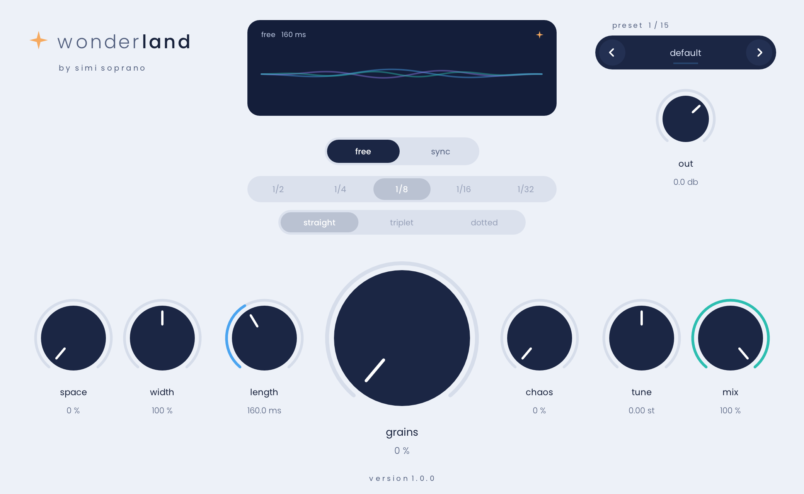

# wonderland by simi soprano

a free, dreamy ambience plugin: a granulizer that can float freely or chop in time with your daw's bpm, a plate reverb and a stereo widener, all in one icy window.



**Formats:** VST3 and CLAP (Windows + macOS), AU and a standalone app (macOS).
Works in FL Studio 2024+ (VST3 or CLAP), Ableton Live, Bitwig, Reaper, Studio One, Cubase, Logic Pro and other modern DAWs.
The macOS build is universal (Apple Silicon + Intel). Windows is built for x64 and ARM64EC.

## Download

Grab the latest zip for your system from the [Releases](../../releases) page.

### Windows

Unzip, then copy `Wonderland.vst3` to `C:\Program Files\Common Files\VST3\`.
For CLAP, copy `Wonderland.clap` to `C:\Program Files\Common Files\CLAP\`.
In FL Studio, open *Options → Manage plugins → Find more plugins*.

### macOS

Unzip and copy:

- `Wonderland.vst3` → `~/Library/Audio/Plug-Ins/VST3/`
- `Wonderland.clap` → `~/Library/Audio/Plug-Ins/CLAP/`
- `Wonderland.component` → `~/Library/Audio/Plug-Ins/Components/`

The builds are not notarized by Apple (Wonderland is free and has no paid developer certificate), so macOS may block them the first time. Run this once in Terminal to clear the download flag:

```bash
xattr -cr ~/Library/Audio/Plug-Ins/VST3/Wonderland.vst3 ~/Library/Audio/Plug-Ins/CLAP/Wonderland.clap ~/Library/Audio/Plug-Ins/Components/Wonderland.component
```

## Using it

See the [manual](Wonderland/manual/Wonderland%20manual.md). Short version: drag or scroll the knobs, double-click to reset, hold Shift for fine control, and click the little led buttons to switch modules on or off.

## Building from source

Built with [iPlug2](https://github.com/iPlug2/iPlug2) (included as a git submodule).

```bash
git clone --recursive https://github.com/IronJoker/Wonderland.git
cd Wonderland/iPlug2/Dependencies/IPlug
./download-vst3-sdk.sh && ./download-clap-sdks.sh
cd ../../..
```

- **macOS:** open `Wonderland/Wonderland.xcworkspace` in Xcode, or run `xcodebuild -workspace Wonderland/Wonderland.xcworkspace -scheme macOS-VST3 -configuration Release build`
- **Windows:** open `Wonderland/Wonderland.sln` in Visual Studio 2022 and build the `Wonderland-vst3` or `Wonderland-clap` project.

GitHub Actions builds and validates both platforms on every push (see the *Actions* tab). Pushing a tag such as `v1.0.0` builds both platforms and publishes a Release with the zips.

## Code layout

| File | What it does |
|------|--------------|
| `Wonderland/WonderlandDSP.h` | All audio processing: granulizer (free + tempo-synced chops), Dattorro plate, widener |
| `Wonderland/WonderlandControls.h` | Custom vector UI: frosted knobs, mini knobs, led toggles, segmented buttons, plasma visualizer, width fader, preset pill |
| `Wonderland/Wonderland.cpp` | Parameters, presets, UI layout and the processing chain |
| `Wonderland/config.h` | Plugin name, IDs, version, window size |
